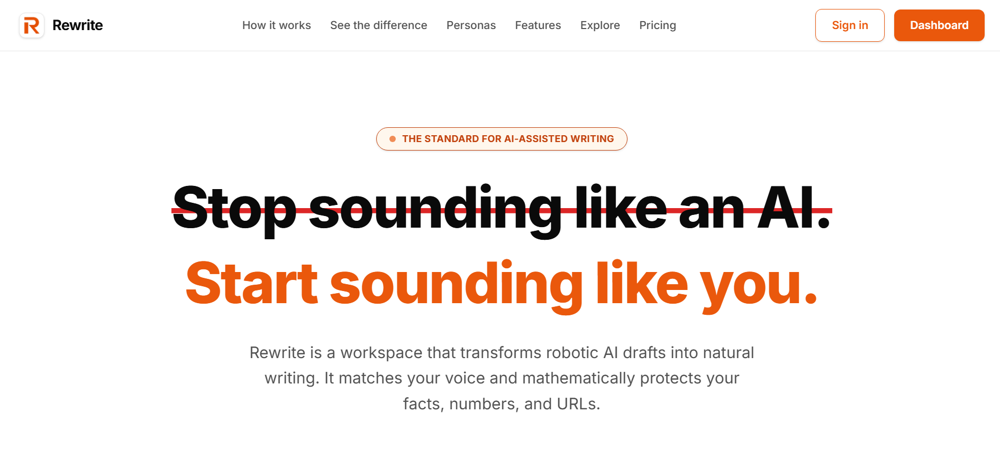
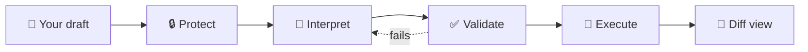
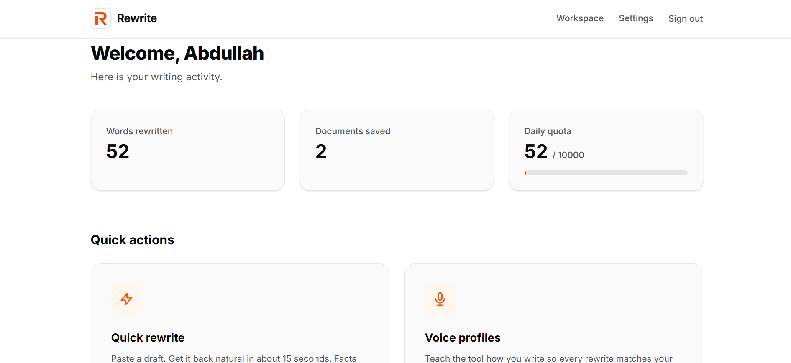
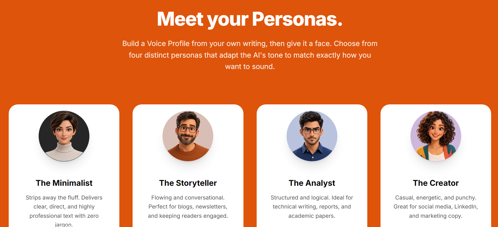
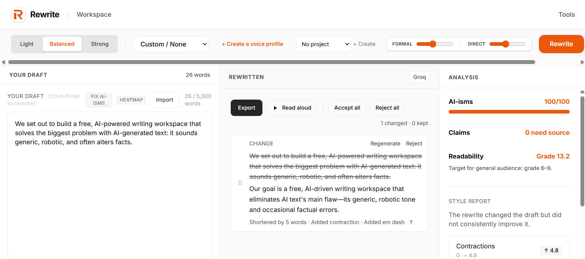
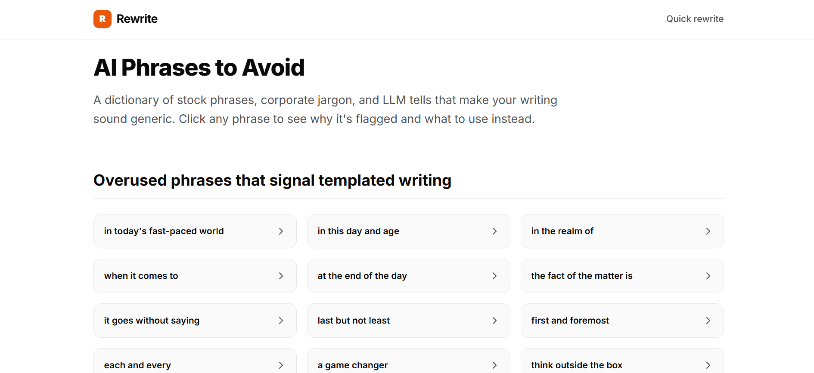
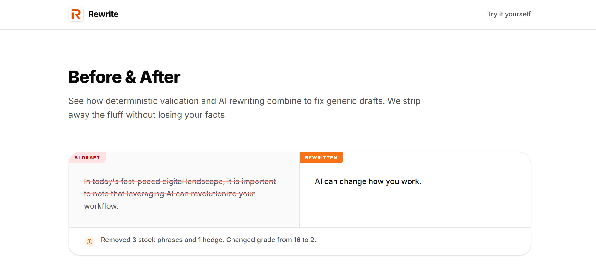

<div align="center">

# ✍️ Rewrite

### Make AI drafts sound like you, without changing a single fact.

A free writing workspace that turns robotic AI text into natural writing, matches your voice, and locks your numbers, URLs, and quotes so the AI can't touch them.

[](https://rewrite-green.vercel.app)




</div>

---

## 📑 Table of contents

- [The idea](#-the-idea)
- [Why not just ask ChatGPT?](#-why-not-just-ask-chatgpt)
- [How it works](#-how-it-works)
- [Architecture](#-architecture)
- [Screenshots](#-screenshots)
- [Tech stack](#-tech-stack)
- [Run it locally](#-run-it-locally)
- [Tests](#-tests)
- [What Rewrite is not](#-what-rewrite-is-not)
- [License](#-license)

---

## 💡 The idea

AI is good at structure. It is bad at sounding human, and it sometimes changes your facts.

Most "humanizer" tools are a thin wrapper around a chatbot. Rewrite works differently. The AI only proposes text. Plain TypeScript code protects your data before the AI sees it, checks the result, and puts everything back. You review every change sentence by sentence.

It runs entirely on free infrastructure (Groq, OpenRouter, Neon, Vercel), so professional editing tools are open to everyone.

---

## 🆚 Why not just ask ChatGPT?

| | Asking a chatbot | Rewrite |
|---|---|---|
| **Your facts** | The model can quietly change numbers, quotes, and links | Facts are replaced with `⟦P1⟧`-style placeholders before the AI sees them. They are restored by code afterward |
| **Seeing changes** | You compare two blocks of text by eye | A sentence-by-sentence diff shows each edit and the reason for it |
| **Control** | Take it or leave it | Accept or reject each sentence on its own |
| **Your voice** | A generic "human" tone | A Voice Profile built from your own writing: sentence length, contraction rate, tone |
| **Unsourced claims** | Silent | The claim flagger marks statistics and dates with no nearby source |
| **Banned words** | You repeat the rule every time | Project glossaries enforce "never use" lists, and output that breaks them is rejected |

---

## ⚙️ How it works

Rewrite is a linear pipeline. The AI is used in one step only. Everything else is deterministic code.



| Stage | Name | What happens |
|:---:|---|---|
| **01** | 🔒 **Protect** | A regex engine finds URLs, numbers, quotes, and citations and swaps them for tokens like `⟦P1⟧` and `⟦P2⟧` |
| **02** | 🧠 **Interpret** | The masked text, your chosen Persona, and the Tone Dials go to the LLM (Groq or OpenRouter), which must reply in strict JSON |
| **03** | ✅ **Validate** | Code checks the JSON schema, confirms every token survived, scans for forbidden glossary words, and checks length ratios. A failure triggers a retry with a stricter prompt |
| **04** | 🔁 **Execute** | Protected spans are put back into the text, and the Diff View highlights each change for you to review and export |

---

## 🏗️ Architecture

The system keeps AI interpretation and deterministic execution strictly apart.

```text
sources → protect → LLM → validate → restore → diff
```

| Layer | What it does |
|---|---|
| **Frontend** | Next.js (App Router), React, Tailwind CSS |
| **AI layer** | One provider-agnostic `chat()` function. Groq is primary and OpenRouter is the fallback |
| **Deterministic core** | Pure TypeScript for linting, claims checking, readability, and diffing. It runs in the browser for the free tools and on the server for validation |
| **Database** | Neon Postgres with Prisma, storing documents, voice profiles, and usage quotas |

> **The AI has no tools, no database access, and cannot run code.** It only proposes text. The code decides what happens with it.

---

## 📸 Screenshots

<table>
  <tr>
    <td width="50%" align="center">
      <br />
      <b>Dashboard</b><br />
      <sub>Word count, daily quota, and active personas</sub>
    </td>
    <td width="50%" align="center">
      <br />
      <b>Free Tools (no AI)</b><br />
      <sub>Linting, claims checking, readability, style meter</sub>
    </td>
  </tr>
  <tr>
    <td width="50%" align="center">
      <br />
      <b>Voice Profiles</b><br />
      <sub>The Voice Coach builds a persona from your samples</sub>
    </td>
    <td width="50%" align="center">
      <br />
      <b>Personas</b><br />
      <sub>Four avatars that shape the AI's tone</sub>
    </td>
  </tr>
  <tr>
    <td width="50%" align="center">
      <br />
      <b>Workspace &amp; Projects</b><br />
      <sub>Folders with project-specific glossaries</sub>
    </td>
    <td width="50%" align="center">
      <br />
      <b>Dictionary</b><br />
      <sub>90+ AI phrases to avoid, and what to write instead</sub>
    </td>
  </tr>
  <tr>
    <td width="50%" align="center">
      <br />
      <b>Examples Gallery</b><br />
      <sub>Before-and-after rewrites</sub>
    </td>
    <td width="50%" align="center">
      <br />
      <b>Web Clipper</b><br />
      <sub>A bookmarklet to rewrite highlighted text on any site</sub>
    </td>
  </tr>
</table>

---

## 🧰 Tech stack

| Layer | Technology |
|---|---|
| Frontend | Next.js (App Router), React, Tailwind CSS |
| Deployment | Vercel |
| Database | PostgreSQL (Neon) |
| ORM | Prisma |
| Auth | Auth.js v5 (Google OAuth) |
| AI providers | Groq, OpenRouter (behind a provider abstraction) |
| Rate limiting | Upstash Redis |
| Validation | Zod |
| Testing | Vitest |

---

## 🚀 Run it locally

### Requirements

| You need | Notes |
|---|---|
| Node.js 18+ | |
| pnpm | |
| A Postgres database | [Neon](https://neon.tech) has a free tier |
| LLM provider API keys | Groq and/or OpenRouter |

### Setup

```bash
# 1. Clone the repo
git clone https://github.com/abdullah804-stack/Rewrite.git
cd Rewrite

# 2. Install dependencies
pnpm install

# 3. Configure environment
cp .env.example .env
# Fill in DATABASE_URL, AUTH_SECRET, and your AI provider keys

# 4. Run database migrations
pnpm prisma migrate dev

# 5. Start the dev server
pnpm dev
```

Then open [http://localhost:3000](http://localhost:3000).

---

## 🧪 Tests

The deterministic core is covered by unit tests in Vitest.

```bash
pnpm test
```

| Area | What the tests check |
|---|---|
| **Protected spans** | `protect()` and `restore()` mask and unmask URLs, numbers, and quotes correctly |
| **Metrics** | Sentence length and reading grade calculations |
| **Diff** | Sentence-by-sentence alignment |
| **Fixes** | Removing AI-isms never breaks syntax |

---

## 🚫 What Rewrite is not

| It is not... | Because... |
|---|---|
| **A detector bypasser** | Detector scores are unreliable, and beating them is not the goal. Rewrite aims to sound human to a human reader |
| **A fact-checker** | The claim flagger points out unsourced statistics but cannot tell you whether they are true. You are the writer |
| **An academic cheating tool** | It is built for content writers, marketers, and professionals. Follow your publisher's disclosure rules |
| **Trained on your data** | Your text goes to the AI only to produce the rewrite. Nothing is used to train models |

---

## 📄 License

Released under the [MIT License](LICENSE).